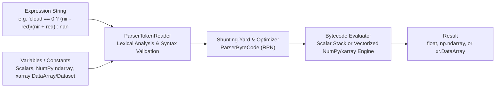

# pymu-eval Documentation

`pymu-eval` (imported as `pymu_eval`) is a pure-Python implementation of the [muParser](https://github.com/beltoforion/muparser) mathematical expression syntax parser and RPN bytecode evaluator. It brings the complete `muParser` syntax—including operator precedence, ternary conditionals, variadic functions, custom operators, localization, and bytecode optimization—directly to Python scalars, **NumPy `ndarray`s**, **`xarray.DataArray`s**, and **`xarray.Dataset`s**.

## Contents

1. [Syntax Guide](syntax_guide.md): Complete reference for built-in operators, precedence rules, functions, constants, ternary expressions, and integer mode (`ParserInt`).
2. [API Reference](api_reference.md): Detailed reference for [`Parser`](../pymu_eval/parser.py), [`ParserBase`](../pymu_eval/parser.py), [`ParserInt`](../pymu_eval/parser.py), [`VariableRef`](../pymu_eval/token_reader.py), [`ParserError`](../pymu_eval/errors.py), and [`eval_expr`](../pymu_eval/parser.py).
3. [NumPy & xarray Guide](numpy_xarray_guide.md): Using `pymu-eval` with multidimensional arrays, labeled `DataArray` coordinates, `Dataset` variable/coordinate bindings, and element-wise conditional masking.
4. [Examples & Interactive Notebook](../examples/pymu_eval_tutorial.ipynb): Standalone scripts and a Google Colab-ready Jupyter Notebook demonstrating real-world scientific and geospatial workflows.

## Architecture Overview

### Key Capabilities

- **Compile Once, Evaluate Many Times**: Expressions are tokenized and compiled into Reverse Polish Notation (RPN) bytecode ([`ParserByteCode`](../pymu_eval/bytecode.py)) on the first evaluation. Subsequent evaluations reuse the compiled bytecode without re-parsing the string.
- **Constant Folding & Algebraic Optimization**: Constant sub-expressions are pre-evaluated at compile time, and linear/polynomial patterns (`a*x + b`, `x^2`, `x^3`, `x^4`) are compiled into specialized instructions (`cmVARMUL`, `cmVARPOW2`–`cmVARPOW4`).
- **Dual Vector / Scalar Execution**:
  - When all inputs are scalars, `pymu-eval` uses fast scalar stack evaluation with short-circuiting jumps for `cond ? then : else`.
  - When any input is a `numpy.ndarray` or `xarray.DataArray`, `pymu-eval` automatically dispatches to vectorized `numpy` / `xarray` operations, preserving `xarray` dimensions and coordinates and evaluating ternary `cond ? then : else` element-wise via `xarray.where` / `numpy.where`.
- **Dual API Naming**: Every method on [`ParserBase`](../pymu_eval/parser.py) supports both Pythonic `snake_case` (e.g., `set_expr`, `define_var`, `eval`) and C++ `muParser` `CamelCase` (e.g., `SetExpr`, `DefineVar`, `Eval`).
